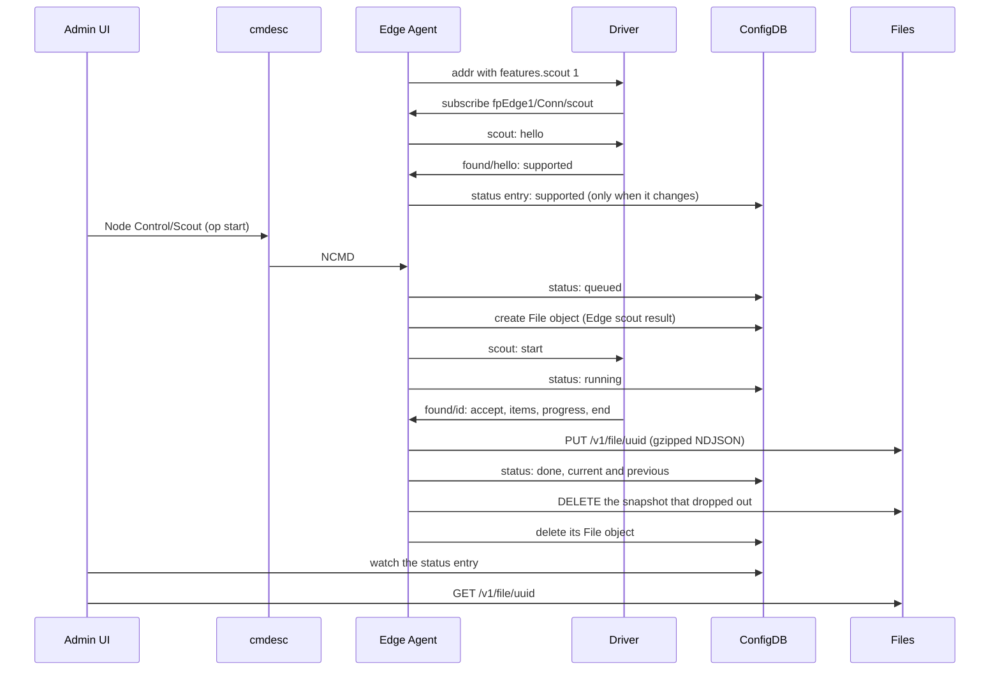

# Edge Scout reference

This page lists the formats, names and permissions Edge Scout uses, for
anyone who reads or writes them outside the Admin UI. The operator
guide is [Scanning a device for addresses](edge-scout-scanning.md), the
guide for driver authors is
[Adding scouting to a driver](edge-scout-drivers.md), and the design
and the reasons behind it are in [Edge Scout design](edge-scout.md).

The normative text for the driver protocol is the "Scouting" section of
[`acs-edge/docs/edge-split.md`](../../../acs-edge/docs/edge-split.md).
Every message, the status entry and each snapshot line has a JSON
Schema (draft 2020-12) in
[`lib/edge-scout-schemas`](../../../lib/edge-scout-schemas/README.md),
with valid and invalid fixtures that every implementation tests
against. Where this page and the schemas differ, the schemas win.

## How the pieces fit



## The Node Control/Scout command

The Admin UI starts and stops scans with the node command
`Node Control/Scout`, type `String`, sent through the Command
Escalation service (`CmdEsc.request_cmd`), in the same way as the
Rebirth button sends `Node Control/Rebirth`. The Edge Agent lists the
metric in its NBIRTH with the value `""`, so the UI can tell an agent
that can scan from one that cannot.

The value is a JSON string, checked against `ncmd.schema.json`:

```json
{"version": 1, "op": "start",
 "request": "c1d2e3f4-a5b6-4c7d-8e9f-0a1b2c3d4e5f",
 "connection": "5d0c7f3e-8a21-4c55-9a7e-0f6b1d2c3e4a",
 "root": null, "folder_id": null, "options": {}}

{"version": 1, "op": "cancel",
 "request": "d2e3f4a5-b6c7-4d8e-9f0a-1b2c3d4e5f60",
 "connection": "5d0c7f3e-8a21-4c55-9a7e-0f6b1d2c3e4a"}
```

Key|Meaning
---|---
`version`|Always 1, for both `start` and `cancel`
`op`|`start` or `cancel`
`request`|A new lower-case UUID for each request. The status entry echoes it, so the browser that sent the request can find the answer
`connection`|The connection's UUID, also lower case
`root`|Where to start, in the driver's own terms, or null for the device's natural top. Optional
`folder_id`|For a branch scan, the `id` of the folder to replace. Needs `root`. Optional
`options`|Driver options, at most 8 KiB as JSON. Optional
`limits`|Optional caps: `items`, `depth`, `seconds`, `pace_ms` and `samples`. The agent fills in the defaults and clamps to the ceilings below. The Admin UI does not send it

cmdesc answers 200 as soon as it has published the NCMD, whether or not
the node is up, so the answer says nothing about whether the scan was
accepted. The UI watches the status entry instead.

Limit|Default|Ceiling
---|---|---
`items`|20,000|50,000
`depth`|8|32
`seconds`|120|600
`pace_ms`|20|none (minimum 0)
`samples`|false|

## fpEdge1 protocol additions

These are summaries. The normative text, with every MUST, is the
"Scouting" section of `edge-split.md`.

**The feature key.** Every `addr` packet the Edge Agent publishes
carries `"features": {"scout": 1}`. `version` stays 1. A driver library
reads `features` before anything else in the packet and subscribes to
`scout` only when it has seen the key on the current MQTT session.

**Topics and ACL.**

Topic|Direction|Messages
---|---|---
`fpEdge1/<Conn>/scout`|Edge Agent to driver|`hello`, `start`, `cancel`
`fpEdge1/<Conn>/found/<id>`|driver to Edge Agent|`hello` (on `found/hello`), `accept`, `items`, `progress`, `end`

The driver broker's ACL allows `found/\w+` on publish and `scout` on
subscribe. Edge Agents before this release refuse both and drop the
driver's connection, which is why the subscription waits for the
feature key.

**Edge Agent to driver** (`request.schema.json`):

```json
{"op": "hello", "version": 1}
{"op": "start", "id": "3f9c1a2b44e04d0c9a7e5b1f2c3d4e5f", "version": 1,
 "root": null, "folder_id": null, "options": {},
 "limits": {"items": 20000, "depth": 8, "seconds": 120, "pace_ms": 20, "samples": false}}
{"op": "cancel", "id": "3f9c1a2b44e04d0c9a7e5b1f2c3d4e5f"}
```

The scan `id` is the scan's UUID without dashes.

**Driver to Edge Agent** (`found.schema.json`):

```json
{"seq": 0, "type": "hello", "versions": [1], "supported": true, "library": "rs-edge-driver 0.1.0"}
{"seq": 0, "type": "accept"}
{"seq": 1, "type": "items", "items": [ITEM, ...]}
{"seq": 2, "type": "progress", "visited": 3400, "found": 1200, "note": "ns=2;s=Line1"}
{"seq": 9, "type": "end", "exhaustive": true, "truncated": false, "reason": null,
 "excluded": [{"id": "i=2253", "reason": "skipped", "prefixes": ["i="]}]}
{"seq": 0, "type": "end", "error": {"code": "OPTIONS", "message": "Root ns=2;s=Nope does not exist"}}
```

An `items` message holds 1 to 500 items and at most 256 KiB. `seq`
goes up by 1 for each message of a scan, and a gap ends the scan with
`LOST`.

**An item** (`item.schema.json`):

```json
{"id": "ns=2;s=Line1/Speed", "parent": "ns=2;s=Line1", "name": "Speed",
 "kind": "value", "address": "ns=2;s=Line1/Speed", "path": null,
 "type": "Double", "access": "rw", "unit": "rpm", "description": "Spindle speed",
 "sample": null, "more": false, "root": null,
 "detail": {"namespace_uri": "urn:plc:line1"}}
```

Key|Rule
---|---
`id`|Required, 1 to 512 characters, unique in the scan, and derived from the device alone
`parent`|Required, the parent's `id` or null
`name`|Required, at most 256 characters
`kind`|Required, `folder` or `value`
`address`|Required for a value, in the driver's canonical form, at most 1024 characters
`path`|The metric path inside the address's data packet, or null, at most 1024 characters
`type`|A Sparkplug B type name without byte order (`Int16`, `Double`, `UUID` and so on), or null
`access`|`r`, `w`, `rw` or null
`unit`|At most 64 characters
`description`|At most 1024 characters
`sample`|The current value as text, at most 256 characters, only when `limits.samples` is true
`more`|`true` on a folder whose children the scan did not list
`root`|What to send as `root` to scan this folder on its own. Defaults to `id`
`detail`|An object of driver-specific facts, at most 2 KiB as JSON

The Edge Agent strips keys that are not in this table, cuts strings
that are too long, then checks each item on its own. It drops an item
that still fails, or whose `id` repeats, and counts it in `rejected`.
An item whose `detail` is over 2 KiB keeps its other fields with
`detail` set to null.

## Codes

Code|Set by|Meaning
---|---|---
`UNSUPPORTED`|driver|The driver does not implement scouting
`OPTIONS`|driver, or the Edge Agent for a branch|Bad `root`, `folder_id` or options. The Edge Agent sets it itself when a branch scan's `folder_id` is not in the current snapshot, or there is no current snapshot
`CONN`|driver|The driver cannot reach its device
`AUTH`|driver|The device refused the driver
`CANCELLED`|driver, or the Edge Agent for a queued scan|Stopped by the operator or by a new driver configuration. The Edge Agent sets it when a scan is stopped before it reaches the driver
`ERR`|driver|Any other driver failure, with the message
`REQUEST`|Edge Agent|The NCMD value is malformed, or `options` is over 8 KiB
`UNDEPLOYED`|Edge Agent|The connection is not in this agent's configuration, or it is not a split driver
`NODRIVER`|Edge Agent|The driver is not connected or not `UP`, it started less than 10 s ago and has not subscribed yet, or the agent is restarting
`LIBRARY`|Edge Agent|The driver has been `UP` for 10 s without subscribing to `scout`, so its library predates scouting
`BUSY`|Edge Agent|A scan is already queued or running on this connection
`LIMIT`|Edge Agent|The agent runs as many scans as it allows and 4 more are queued
`NOTRUNNING`|Edge Agent|A cancel named a connection with no queued or running scan
`TIMEOUT`|Edge Agent|Nothing arrived from the driver for 30 s, or the scan passed `seconds` plus 15 s
`LOST`|Edge Agent|A gap in `seq`
`INTERRUPTED`|Edge Agent|The agent restarted, or the driver disconnected, left `UP` or sent a new hello during the scan
`STORE`|Edge Agent|An upload, download or status write failed. The message names the Files or ConfigDB answer
`AGENT`|Edge Agent|Any other agent failure, including a `found` message that is not JSON or fails its schema

`REQUEST`, `UNDEPLOYED`, `NODRIVER`, `LIBRARY`, `BUSY`, `LIMIT` and
`NOTRUNNING` are refusals. They go only in the status entry's
`last_request` and never touch the scan fields, so a refused request
never disturbs a scan that is already running.

## The status entry

ConfigDB app `Edge.App.ScoutStatus`, one entry per connection, keyed by
the connection's UUID. Only the Edge Agent writes it. Its ConfigSchema
is `lib/edge-scout-schemas/schemas/status.schema.json`, which
service-setup copies into `dumps/edge.yaml`. The schema allows no other
keys.

```json
{"version": 1, "node": "9b2e4c6d-1f3a-4b5c-8d7e-6f5a4b3c2d1e", "supported": true,
 "scan": "3f9c1a2b-44e0-4d0c-9a7e-5b1f2c3d4e5f",
 "request": "c1d2e3f4-a5b6-4c7d-8e9f-0a1b2c3d4e5f",
 "state": "done", "code": null, "message": null,
 "started": "2026-11-24T10:41:00Z", "updated": "2026-11-24T10:42:13Z",
 "finished": "2026-11-24T10:42:13Z",
 "root": null, "folder_id": null,
 "options_hash": "sha256:...", "config_hash": "sha256:...",
 "progress": null,
 "last_request": {"request": "c1d2e3f4-...", "code": null, "message": null,
                  "at": "2026-11-24T10:41:00Z"},
 "current": {"file": "e3f4a5b6-...", "items": 9812, "bytes_gz": 402113,
             "exhaustive": true, "truncated": false, "reason": null,
             "finished": "2026-11-24T10:42:13Z", "root": null,
             "options_hash": "sha256:...", "config_hash": "sha256:...",
             "excluded": [{"id": "i=2253", "reason": "skipped", "prefixes": ["i="]}],
             "branches": [{"folder_id": "ns=2;s=Line1/Motor",
                           "finished": "2026-11-24T10:45:02Z"}]},
 "previous": null}
```

Key|Meaning
---|---
`version`|Always 1. Required
`node`|The UUID of the Edge Agent that wrote the entry. Required. The Admin UI ignores an entry whose `node` is not the node that hosts the connection, because ConfigDB lets any agent write any entry of this app
`supported`|`true`, `false`, `"library"` (the driver predates scouting) or null when not yet known. Required. The agent writes it only when it changes
`scan`|The UUID of the latest accepted scan, which is also its snapshot's File object
`request`|The `request` UUID that started that scan
`state`|`queued`, `running`, `done`, `failed` or `cancelled`. Saving the snapshot shows as `running`
`code`, `message`|The code and message a `failed` or `cancelled` scan ended with. `message` is at most 512 characters
`started`, `updated`, `finished`|RFC 3339 times in UTC
`root`, `folder_id`|The latest scan's start point, each at most 1024 characters
`options_hash`|`sha256:` and 64 lower-case hex digits, over the scan's options in canonical JSON
`config_hash`|The same form, over the connection's `connType`, `driverId` and `DriverDetails` as stored, before secrets are filled in
`progress`|`{visited, found, note}` while the scan runs, rewritten at most every 2 s
`last_request`|`{request, code, message, at}` for the latest request of any kind. `code` is null when the request was accepted, or a refusal code
`current`, `previous`|The two snapshots kept, or null

A snapshot reference (`current` or `previous`) has `file`, `items`,
`bytes_gz`, `exhaustive`, `truncated`, `reason`, `finished`, `root`,
`options_hash`, `config_hash`, `excluded` (at most 8 scopes, each with
up to 4 prefixes of up to 256 characters) and `branches` (the last 10
branch scans merged into it, as `{folder_id, finished}`).

The schema keeps the largest possible entry at about 50 KB, under
ConfigDB's 100kb body limit. The agent keeps its own entries under
16 KiB serialised: it drops the oldest `branches` first, then the
`prefixes` of `excluded` scopes, and logs that it did. A typical entry
is under 2 KB.

## The snapshot

A snapshot is gzipped NDJSON, stored in the Files service under a File
object of class `Edge.Class.ScoutResult`. The Edge Agent uploads it with
`Content-Type: application/octet-stream` and
`Original-Filename: scout-<uuid>.ndjson.gz`.

```
{"version":1,"scan":"3f9c...","connection":"5d0c...","driver":"rs-edge-driver 0.1.0","started":"2026-11-24T10:41:00Z","root":null,"folder_id":null,"options":{}}
{"id":"ns=2;s=Line1","parent":null,"name":"Line1","kind":"folder"}
{"id":"ns=2;s=Line1/Speed","parent":"ns=2;s=Line1","name":"Speed","kind":"value","address":"ns=2;s=Line1/Speed",...}
{"end":{"finished":"2026-11-24T10:42:13Z","exhaustive":true,"truncated":false,"reason":null,"excluded":[...],"rejected":0,"items":2,"branches":[]}}
```

- **Header**, the first line: `version`, `scan`, `connection`,
  `driver` (the `library` string from the driver's hello, or null),
  `started`, `root`, `folder_id` and `options`. A snapshot merged from
  a branch scan carries the base snapshot's `root` and `options`, and
  the branch's `folder_id`.
- **Items**, one per line, in the item format above.
- **End**, the last line: `finished`, `exhaustive`, `truncated`,
  `reason`, `excluded`, `rejected` (items the agent dropped, summed
  over the base and the branch for a merged snapshot), `items` (the
  number of item lines) and `branches`.

A reader treats a snapshot as invalid when it has no end line, the
first line is not a header, the `items` count does not match, or an
`id` repeats. `check_snapshot` in `lib/edge-scout-schemas` checks all
of this. Item order is not significant.

Measured sizes: a 20,445-item OPC UA scan from the test server is
6.8 MB raw (334 bytes an item) and 208 KB gzipped, and a 49,950-item
edge-test-rs scan is 865 KB gzipped. The test servers' names repeat
more than real ones, so expect real scans to compress less.

### Retention

Each connection keeps `current` and `previous`. When a scan finishes,
`current` becomes `previous` and the old `previous` is deleted: Files
`DELETE` first, then the ConfigDB object. A failed or cancelled scan
deletes its own File object. A branch scan merges into a new snapshot,
which then becomes `current` in the same way.

Deleting a connection deletes its status entry with it. On every
upgrade, a service-setup fixup sweeps `Edge.Class.ScoutResult` objects
that nothing refers to. It keeps an object when any of these holds:

- a status entry names it as `current.file` or `previous.file`
- a status entry names it as `scan` and is `queued` or `running`, or
  was updated less than a day ago
- its Files upload record is less than a day old

It deletes the Files content first and the ConfigDB object only after
Files answers 204. It deletes nothing when it cannot read the status
entries.

## UUIDs

Constant|UUID|What
---|---|---
`Edge.App.ScoutStatus`|`ad73fae4-a3b9-457a-8c36-12a2019bff2c`|App "Edge scout status", a subclass of `MetaDB.Class.ConfigEntry`
`Edge.Class.ScoutResult`|`10916e96-f6fe-44cc-8c01-16a775426038`|R1 class "Edge scout result", a subclass of `Files.Class.File` and a member of `Files.Class.FileGroup`
`Edge.Perm.Scout`|`41443382-ecad-439b-999f-cb611bc11f7c`|Permission "Scan device addresses", a member of `ACS.PermGroup.CmdEsc`. The CmdDef for `Node Control/Scout` is keyed by it
`Files.Perm.Delete`|`82a2206b-b9d8-4eee-bc0e-63fb8785019e`|Permission "Delete", a member of `Files.Perm.All`

They are defined in `acs-service-setup/lib/uuids.js`,
`acs-edge/lib/uuids.ts` and, for `Files.Perm.Delete`,
`acs-files/lib/constants.js`.

## Permissions and grants

**Who may scan.** Sending `Node Control/Scout` needs `Edge.Perm.Scout`
on the Edge Agent's node. The permission is in `ACS.PermGroup.CmdEsc`,
and administrators hold that whole group, as well as ConfigDB and
`Files.Perm.All`, so they can scan and read results with no new grant.
Nobody else can scan in this release.

**What the Edge Agent holds.** service-setup grants these to
`Local.Role.EdgeAgent` in `dumps/helm.yaml`:

Permission|Target|Wild|Why
---|---|---|---
`ConfigDB.Perm.ReadConfig`|`Edge.App.ScoutStatus`|no|Read the status entries
`ConfigDB.Perm.WriteConfig`|`Edge.App.ScoutStatus`|no|Write the status entries
`ConfigDB.Perm.CreateObject`|`Edge.Class.ScoutResult`|no|Create one File object per scan
`ConfigDB.Perm.DeleteObject`|`Edge.Class.ScoutResult`|yes|Delete snapshots that drop out
`Files.Perm.Upload`|`UUIDs.Special.Null`|no|Upload a snapshot. Files checks Upload against the null UUID, not the file
`Files.Perm.Download`|`Edge.Class.ScoutResult`|yes|Read the current snapshot back for a branch merge
`Files.Perm.Delete`|`Edge.Class.ScoutResult`|yes|Delete snapshot content

The Admin UI reads results with the operator's own credentials, so an
operator needs `Files.Perm.Download` on the snapshots and ConfigDB read
access to the status app, which administrators have.

## Files DELETE route

`DELETE /v1/file/:uuid` on the Files service removes a file's stored
content and its upload record. The File object in ConfigDB stays, and
the caller deletes it afterwards if it wants to.

Answer|When
---|---
204|The content and the record are gone, or there was none. Repeating the call answers 204 again
400|The UUID is not valid. This is checked before anything else
403|The caller lacks `Files.Perm.Delete` on the file. The check is made against the file's UUID with class grants applied, so it also answers 403 for an object that no longer exists or is no longer in a granted class
503|Removing the upload record from ConfigDB failed. A retry finishes the job

An upload still in progress (a `<uuid>.temp` file) is left alone.

## Edge Agent settings

Variable|Default|Meaning
---|---|---
`SCOUT_MAX_CONCURRENT`|1|Scans the agent runs at once. One per connection at most, and 4 more may queue
`SCOUT_MAX_BYTES`|33554432 (32 MiB)|Largest snapshot before compression. A scan that reaches it ends truncated with reason `size`
`SCOUT_MAX_GZ_BYTES`|8388608 (8 MiB)|Largest snapshot after compression, with the same effect
`SCOUT_SCHEMA_DIR`|the installed `@amrc-factoryplus/edge-scout-schemas`|Where the agent reads the JSON Schemas from. Only for testing

There is no setting that turns scanning off. The edge-agent Helm chart
does not set these variables yet, so an agent uses the defaults.

## DriverDef `scout` key

A driver definition (`Edge.App.DriverDef`) may carry a `scout` key that
tells the Admin UI how to show the Addresses panel:

```yaml
scout:
  title: "Scan the server's address space"   # tooltip of the Scan button
  address_form: opcua    # opcua, mqtt or exact (the default)
  options:               # JSON Schema for the options form
    type: object
    properties:
      include_server: { type: boolean, default: false }
  share_samples: false   # let a custom driver UI see item samples
```

- With no `scout` key the panel shows and trusts the driver's hello.
  This covers external drivers and drivers outside this repository.
- `scout: false` hides the panel.
- `address_form` picks how the UI compares a metric's address with a
  scanned one. `opcua` drops `ns=0;` and compares an index range such
  as `node[2:5]` with its base node unless the scan listed that exact
  element. `mqtt` and `exact` compare the address unchanged.
- The UI builds the options form from `options.properties`: booleans
  become ticks, integers and numbers become number fields, arrays
  become comma-separated lists and anything else a text field. It
  fills in each `default` and sends the options as they are. Drivers
  check their own options, so only list options the driver reads.

## Driver custom UI contract version 2

Version 2 of the driver custom UI contract lets a driver's own HTML
panel ask for an address from the scan. It is documented in
[Driver-supplied configuration UIs](driver-custom-uis.md#contract-version-2-edge-scout).
